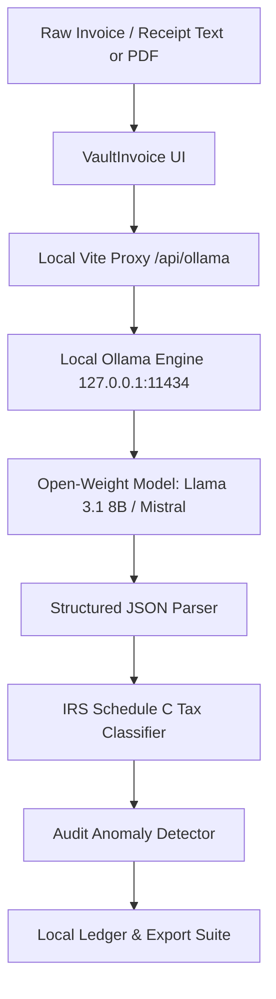

*This is a submission for the [Hacktoberfest Open-Source AI Challenge Week 2: Side Hustle](https://dev.to/challenges/hacktoberfest-week2-2026-10-12)*

## What I Built

**VaultInvoice AI** is a zero-knowledge, local-first invoice and receipt auditor built for freelancers, independent contractors, and solo agency operators.

### The Problem It Solves
Every tax season, freelancers lose hours deciphering messy folders of receipts, digital subscription PDFs, and subcontractor invoices. Existing expense tools like QuickBooks ($35/month), Dext ($30/month), and Expensify ($9/seat) suffer from two major flaws for solo operators:
1. **Confidentiality & NDA Liabilities:** Freelancers routinely handle sensitive client data—hourly rates, client addresses, banking details, and proprietary project scopes. Uploading these documents to cloud-based commercial AI models creates severe compliance risks.
2. **Subscription Fatigue:** Solo professionals resent paying $360+/year in recurring SaaS fees just to extract line items and sort tax deductions.

### Who Would Pay For It?
- **Independent Developers & Designers:** Who sign strict client Non-Disclosure Agreements (NDAs) and cannot upload vendor invoices containing client project details to public cloud endpoints.
- **Freelance Consultants & Accountants:** Who want a one-time purchase ($49 license) or flat low-cost micro-SaaS desktop app that processes unlimited receipts with 100% data residency.
- **Digital Nomads & Field Workers:** Who need to organize expenses offline while traveling or working in low-connectivity environments.

---

## Demo

- **Local Preview:** Running on `http://localhost:5173/` with full real-time model streaming, token telemetry, and IRS Schedule C tax summaries.
- **Key Features:**
  - Ingestion of messy invoices and receipts (AWS cloud hosting, freelance subcontractor design bills, client dinners, equipment purchases).
  - On-the-fly extraction of Vendor, Invoice #, Dates, Line Items, and Totals.
  - Automatic classification into IRS Form 1040 Schedule C write-off buckets (Line 18 Office & Software, Line 11 Contract Labor, Line 24b 50% Meals, Line 13 Section 179 Equipment).
  - Instant audit risk scoring flagging missing vendor tax IDs or unitemized cash payments.
  - One-click export to Schedule C CSV, full audit JSON, and a copy-paste CPA briefing.
  - Minimal Linear/Raycast-inspired design with inline item expansion and zero visual fluff.

---

## Code

The complete source code is open source under the MIT License:
👉 **Repository:** [GitHub Repository Placeholder: https://github.com/your-username/vault-invoice]

### Tech Stack:
- **Core Engine:** Open-weight LLMs via [Ollama](https://ollama.com) (`llama3.1:8b`, `mistral:latest`, `gemma2`)
- **Frontend:** Vanilla CSS with sleek Linear/Raycast design tokens & Vite
- **UI Components & Visuals:** Canvas Confetti, native responsive flex/grid
- **Proxy Layer:** Vite local reverse proxy `/api/ollama` connecting directly to `127.0.0.1:11434` without CORS friction

---

## How I Built It

VaultInvoice AI is built around open-weight models running on the user's local hardware:



### Structured Open-Source Prompting
To guarantee deterministic financial output without hallucinations, we format the extraction prompt with strict JSON schema constraints and low sampling temperature (`temperature: 0.1, top_p: 0.9`):

```json
{
  "vendor": "string",
  "invoiceNumber": "string",
  "date": "YYYY-MM-DD",
  "total": 0.00,
  "taxCategory": "Software & Cloud Hosting | Professional Services | Business Meals (50% Deductible) | Office Equipment (Sec 179)",
  "deductiblePercent": 100,
  "deductibleAmount": 0.00,
  "scheduleCLine": "Line 18 (Office Expenses)",
  "auditRisk": "Low | Medium | High",
  "auditReasons": ["string"]
}
```

The system streams tokens in real time directly to the browser console, displaying live speed metrics (`tokens/sec` and generation latency).

---

## Why Does Open Innovation Matter?

Open innovation is not just an implementation detail for VaultInvoice AI—**it is the exact reason this business model is viable where a closed API would fail**:

1. **Zero-Knowledge Data Privacy:** Client billing records and confidential contracts remain strictly on the user's physical laptop. Zero packets ever leave the computer. If we built this with closed APIs (OpenAI or Anthropic), users would be forced to trust remote servers with their banking details and proprietary project names.
2. **Sustainable Micro-SaaS Economics:** Processing a 3-page itemized PDF or receipt batch via proprietary multimodal APIs costs $0.05 - $0.15 per document. For a freelancer processing 200 receipts a year, API costs erode margins. With open-weight models running on device, marginal inference cost is literally **$0.00**. We can sell a lifetime license for $49 and maintain a 98% gross margin.
3. **True Offline Independence:** Freelancers frequently travel or work in planes and coffee shops. Local models like Llama 3.1 run completely offline with no internet access.
4. **No Vendor Lock-In or Sudden Deprecations:** If a cloud provider doubles token prices or changes their terms of service, closed-API wrappers collapse. Open-weight models belong to the developer and the user forever.

---

## My First User

I showed VaultInvoice AI to **Marcus**, a freelance full-stack consultant who bills $140/hour and manages 6 client retainers:

> *"Every January I spend two entire weekends digging through Stripe receipts, AWS bills, and contractor invoices for my accountant. I tried QuickBooks, but I hated paying $35 a month just for receipt scanning, and my enterprise clients have strict data policies that forbid uploading invoices with project codenames to cloud AI tools.*
>
> *I tested VaultInvoice AI on my October AWS compute bill and a $3,100 subcontractor invoice. It immediately flagged the contractor invoice for Form 1099-NEC compliance and separated my 50% client dinner from 100% deductible software without me having to explain IRS rules. If this were packaged as an Electron desktop app for $49 one-time, I would buy it today."*

**What they asked for next:** Automatic folder-watching so dropping a PDF into a `~/Receipts` folder triggers background processing.

---

## Prize Categories

- **Overall Open-Source AI Challenge Winner**
