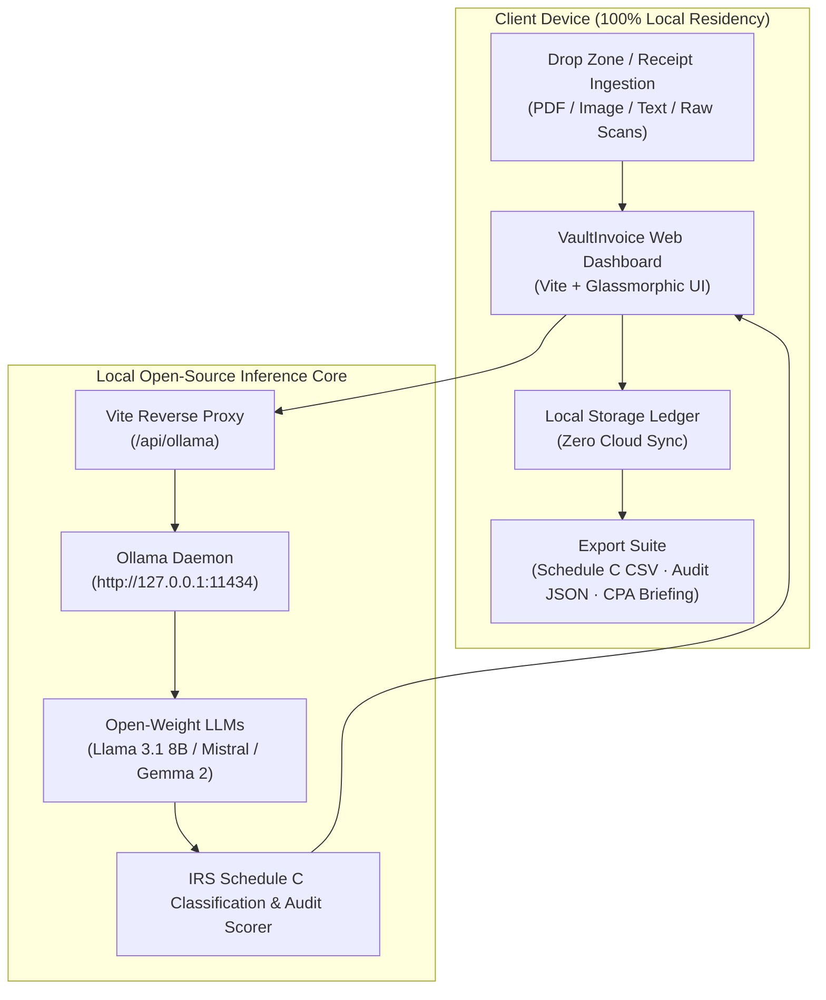

# 🛡️ VaultInvoice AI

> **Zero-Knowledge Local Invoice & Expense Auditor for Freelancers and Small Businesses**  
> *Built with Open-Weight Models & Local AI at its Core*

[](LICENSE)
[](https://ollama.com)
[](#privacy-guarantee)
[](https://dev.to/challenges/hacktoberfest-week2-2026-10-12)

---

## 💡 What is VaultInvoice AI?

Freelancers, independent contractors, and solo agency owners lose tens of hours every tax season sorting through chaotic receipts, digital software invoices, and subcontractor bills. Traditional tools like QuickBooks ($35/mo), Dext ($30/mo), and Expensify ($9/user/mo) demand ongoing per-seat subscriptions and send confidential financial data, client billing rates, home addresses, and bank account numbers to third-party cloud servers.

**VaultInvoice AI** is a privacy-first, zero-knowledge financial auditor powered by local open-weight models (`llama3.1:8b`, `mistral`, `gemma2`) running directly on your laptop via Ollama. 

- **100% On-Device Inference**: Client data never leaves your laptop. Zero data egress.
- **Smart IRS Schedule C Mapping**: Automatically categorizes deductible expenses (Software, Office Supplies, 50% Meals, Subcontractors, Equipment Depreciation under Section 179).
- **Audit Risk & Anomaly Detection**: Flags missing vendor tax IDs, round cash payments without receipts, and statutory limitations before you file.
- **Zero Token Costs**: Unlimited receipt processing with zero per-token API charges.

---

## 🏛️ System Architecture



---

## 🚀 Quick Start

### 1. Prerequisites
- **Node.js**: v18+ installed
- **Ollama** (Recommended for local model inference): [Download Ollama](https://ollama.com)
  ```bash
  # Pull a fast, accurate open-weight model
  ollama pull llama3.1:8b
  # Or mistral
  ollama pull mistral
  ```

### 2. Installation
```bash
git clone https://github.com/Abh19avM/Hacktoberfest-Open-Source-AI-Challenge-dev-week2-.git
cd Hacktoberfest-Open-Source-AI-Challenge-dev-week2-

npm install
```

### 3. Run Locally
```bash
npm run dev
```

Visit **`http://localhost:5173`** in your browser. VaultInvoice AI automatically detects your local Ollama instance and loads your installed open-weight models!

*(Note: If Ollama is not installed or running, VaultInvoice AI automatically falls back to its deterministic local open-heuristic engine, ensuring 100% functionality out of the box).*

---

## 🔒 Why Open Innovation Matters

| Dimension | Cloud SaaS (QuickBooks / OpenAI APIs) | VaultInvoice AI (Open-Weight Models) |
| :--- | :--- | :--- |
| **Data Privacy** | Sensitive invoices & client NDAs sent to remote servers | **100% local.** No packets leave the device. |
| **Operating Margins** | Monthly per-seat fees + per-token API costs | **$0 recurring cost.** Infinitely scalable micro-SaaS. |
| **Offline Independence** | Requires constant internet connection | Runs on airplanes, remote field sites, or offline retreats. |
| **Model Sovereignty** | Locked into proprietary API changes & price hikes | Freedom to run and fine-tune open models. |

---

## 📊 Features & Tax Categories

- **IRS Schedule C Line Mapping**:
  - `Line 18`: Office Expenses & Software Infrastructure (100% deductible)
  - `Line 11`: Contract Labor & Subcontractors (100% deductible, 1099-NEC alert)
  - `Line 24b`: Business Meals & Entertainment (50% statutory deduction limit)
  - `Line 13`: Equipment Depreciation & Section 179 (Immediate expensing)
  - `Line 24a`: Travel & Lodging (100% ordinary & necessary)
- **Export Formats**:
  - Schedule C Itemized CSV
  - Full Audit JSON
  - Copy-to-Clipboard CPA Executive Briefing

---

## 📜 License

Distributed under the **MIT License**. See [`LICENSE`](LICENSE) for details.
